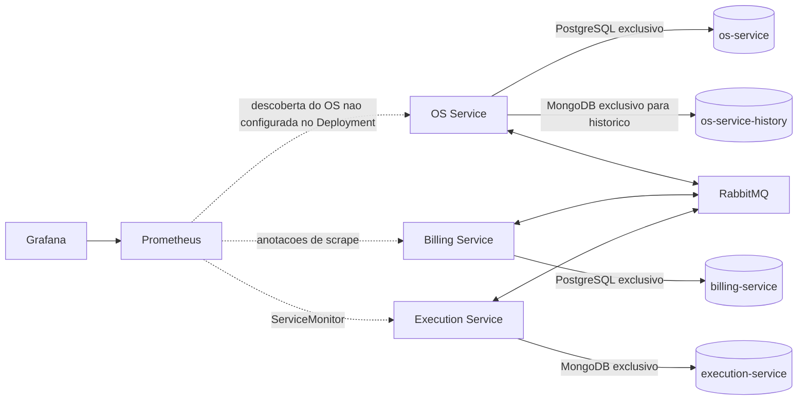

# Tech Challenge - infraestrutura compartilhada

Infraestrutura como código para os microsserviços de Ordem de Serviço, Billing e Execução. O ambiente AWS com Amazon EKS já está provisionado e em uso. Este repositório mantém também um ambiente Kind local e efêmero para desenvolvimento, demonstração e validação; o Terraform aqui versionado provisiona esse ambiente de validação, não gerencia os recursos AWS existentes.

## Documentação arquitetural

Consulte [`docs/architecture/`](docs/architecture/README.md) para os diagramas
de componentes e sequencia, RFCs/ADRs e justificativa dos bancos e modelos de
dados. O material separa o que esta implementado das decisoes de producao ainda
pendentes.

## Componentes provisionados por esta configuração Terraform

| Componente | Namespace | Uso |
| --- | --- | --- |
| PostgreSQL dedicado | `os-service` | Banco exclusivo do OS Service |
| MongoDB dedicado | `os-service` | Historico de eventos do OS Service |
| PostgreSQL dedicado | `billing-service` | Banco exclusivo do Billing Service |
| MongoDB dedicado | `execution-service` | Banco exclusivo do Execution Service |
| RabbitMQ | `messaging` | Transporte assíncrono de eventos entre serviços |
| Prometheus e Grafana | `observability` | Métricas do cluster e painéis |
| Local Path Provisioner | `local-path-storage` | Volumes persistentes locais para o Kind |

Cada serviço tem seu próprio namespace e instância de banco. Os serviços não devem acessar bancos de outros serviços; a integração ocorre por APIs ou eventos publicados no RabbitMQ. Os endpoints DNS internos estão disponíveis pela saída `database_endpoints`, `rabbitmq_endpoint` e `grafana_endpoint` do Terraform.

Os recursos e endpoints AWS/EKS em uso são provisionados e operados fora desta
configuração Terraform. Os nomes de recursos, região, rede, balanceamento,
armazenamento e políticas específicas desse ambiente não são declarados aqui;
consulte a configuração operacional AWS correspondente para esses detalhes.

Os deployments dos serviços devem usar as credenciais provisionadas como Kubernetes Secrets, sem gravar senhas em manifestos:

| Serviço | Conexão de banco | Secret/credencial |
| --- | --- | --- |
| OS | `os-postgresql.os-service.svc.cluster.local:5432`, database/user `os_service` | Secret `os-postgresql`, chave `password` |
| OS historico | `os-mongodb.os-service.svc.cluster.local:27017`, database `os_service_history`, user `os_service` | Secret `os-mongodb`, chave `mongodb-passwords` |
| Billing | `billing-postgresql.billing-service.svc.cluster.local:5432`, database/user `billing_service` | Secret `billing-postgresql`, chave `password` |
| Execução | `execution-mongodb.execution-service.svc.cluster.local:27017`, database/user `execution_service` | Secret `execution-mongodb`, chave `mongodb-passwords` |
| Todos | `rabbitmq.messaging.svc.cluster.local:5672` | Secret `rabbitmq-credentials` no namespace do serviço; chaves `username` e `password` |



## Requisitos

- Docker em execução (Docker Desktop ou Rancher Desktop);
- Terraform >= 1.6.0;
- Kind, kubectl e PowerShell 5.1 ou superior;
- Acesso à internet para baixar providers e charts Helm.

## Subir e remover o ambiente

Na raiz do repositório, execute:

```powershell
.\scripts\up.ps1
```

O script cria o cluster Kind de três nós, instala o provisionador de volumes local e instala as dependências. Consulte os serviços e endpoints com:

```powershell
Set-Location .\terraform
terraform output
```

As credenciais aleatórias de desenvolvimento podem ser consultadas localmente com `terraform output -json generated_credentials`. Não as inclua em logs, commits ou artefatos compartilhados. Para remover o ambiente:

```powershell
Set-Location ..
.\scripts\down.ps1
```

O estado local do Terraform contém credenciais e é ignorado pelo Git. Não configure um backend remoto sem criptografia, controle de acesso e política de retenção adequados. As credenciais geradas e as configurações de recursos são destinadas apenas ao ambiente local.

## Comunicação, Saga e observabilidade

O RabbitMQ fornece a mensageria necessária à integração desacoplada. A estratégia escolhida é uma Saga coreografada: cada serviço participante reage a eventos e executa sua própria etapa e compensação, sem coordenador central. A escolha favorece o desacoplamento entre serviços e reaproveita a mensageria já prevista. Os contratos podem ser documentados nos repositórios existentes; um repositório exclusivo não é obrigatório.

O fluxo implementado inicia com abertura da OS; o evento `ORDER_CREATED` e
criado pela outbox e recebido pelo Execution Service. A oficina inicia/encerra o
diagnostico, informa o orcamento pela API Billing, registra aprovacao e checkout;
o Billing confirma o pagamento via webhook Mercado Pago e publica o evento para
Execution. A rejeicao cancela a execucao. Falhas definitivas posteriores ao
pagamento registram necessidade de estorno manual (`refundRequired`), sem
executar o reembolso automaticamente. OS e Billing usam outbox; OS registra
inbox, Execution deduplica IDs processados e RabbitMQ envia falhas repetidas para
DLQ. Esses mecanismos reduzem perda/duplicidade, mas nao eliminam a necessidade
de reconciliacao e testes de integracao. A infraestrutura provisiona o broker;
a coreografia e as compensacoes sao implementadas nos microsservicos.

Prometheus e Grafana fornecem a base de métricas e painéis para o cluster.
Execution declara `ServiceMonitor`; Billing usa anotacoes de scrape no pod; OS
expoe Actuator/Prometheus, mas seu Deployment nao declara mecanismo equivalente
de descoberta. A coleta nao e uniforme. Rastreamento distribuido via
OpenTelemetry deve ser integrado a ferramenta de tracing adotada na Fase 3,
pois a configuracao desse ambiente nao esta neste repositorio.

## CI e limites deste repositório

O workflow `Validate infrastructure` formata e valida o Terraform, provisiona a infraestrutura em um cluster Kind efêmero e verifica que os recursos de mensageria e observabilidade ficam prontos. Esse teste de Kind não substitui nem recria o ambiente AWS/EKS já provisionado e em uso. Os pipelines de build, testes, cobertura, análise de qualidade e deploy devem permanecer independentes nos repositórios de cada microsserviço.

O check `Validar infraestrutura` é executado em todos os PRs e em pushes para
`main` ou `feature/**`, sem filtro de arquivos. Configure no GitHub a proteção
de `main` para exigir pull request e esse check após o workflow estar disponível
no PR. O cluster Kind é temporário e serve para validar a infraestrutura local;
os deploys dos microsserviços no ambiente AWS/EKS são fluxos separados.

Configure a proteção da branch `main` nas definições do GitHub para exigir pull request e o workflow de validação. Essa regra é configurada no GitHub e não pode ser aplicada pelo Terraform local deste repositório. As imagens dos microsserviços e seus manifestos não estão aqui porque dependem dos repositórios e nomes de imagem de cada serviço.
