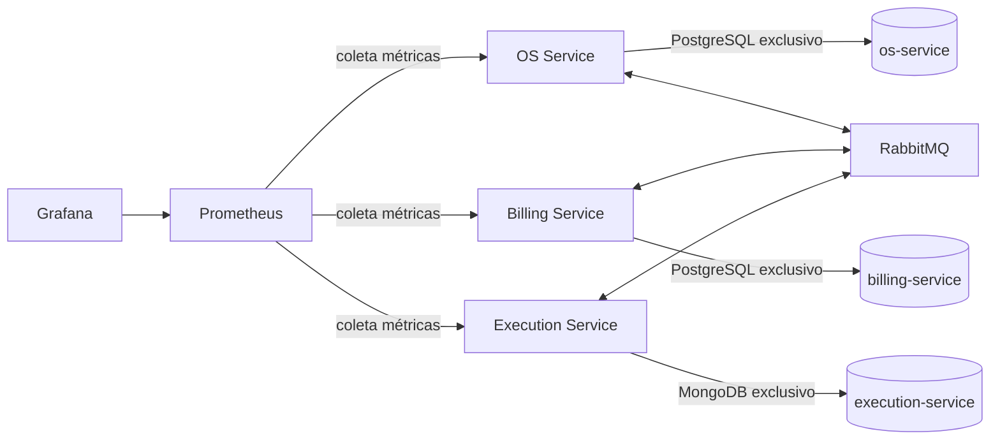

# Tech Challenge - infraestrutura compartilhada

Infraestrutura local como código para os microsserviços de Ordem de Serviço, Billing e Execução. O ambiente usa Kind, Terraform e Helm e foi pensado para desenvolvimento e demonstração; não representa uma configuração pronta para produção.

## O que é provisionado

| Componente | Namespace | Uso |
| --- | --- | --- |
| PostgreSQL dedicado | `os-service` | Banco exclusivo do OS Service |
| PostgreSQL dedicado | `billing-service` | Banco exclusivo do Billing Service |
| MongoDB dedicado | `execution-service` | Banco exclusivo do Execution Service |
| RabbitMQ | `messaging` | Transporte assíncrono de eventos entre serviços |
| Prometheus e Grafana | `observability` | Métricas do cluster e painéis |
| Local Path Provisioner | `local-path-storage` | Volumes persistentes locais para o Kind |

Cada serviço tem seu próprio namespace e instância de banco. Os serviços não devem acessar bancos de outros serviços; a integração ocorre por APIs ou eventos publicados no RabbitMQ. Os endpoints DNS internos estão disponíveis pela saída `database_endpoints`, `rabbitmq_endpoint` e `grafana_endpoint` do Terraform.

Os deployments dos serviços devem usar as credenciais provisionadas como Kubernetes Secrets, sem gravar senhas em manifestos:

| Serviço | Conexão de banco | Secret/credencial |
| --- | --- | --- |
| OS | `os-postgresql.os-service.svc.cluster.local:5432`, database/user `os_service` | Secret `os-postgresql`, chave `password` |
| Billing | `billing-postgresql.billing-service.svc.cluster.local:5432`, database/user `billing_service` | Secret `billing-postgresql`, chave `password` |
| Execução | `execution-mongodb.execution-service.svc.cluster.local:27017`, database/user `execution_service` | Secret `execution-mongodb`, chave `mongodb-passwords` |
| Todos | `rabbitmq.messaging.svc.cluster.local:5672` | Secret `rabbitmq-credentials` no namespace do serviço; chaves `username` e `password` |



## Requisitos

- Docker em execução (Docker Desktop ou Rancher Desktop);
- Terraform >= 1.6.0;
- Kind, kubectl e PowerShell 5.1 ou superior;
- Acesso à internet para baixar providers e charts Helm.

## Subir e remover o ambiente

Na raiz do repositório, execute:

```powershell
.\scripts\up.ps1
```

O script cria o cluster Kind de três nós, instala o provisionador de volumes local e instala as dependências. Consulte os serviços e endpoints com:

```powershell
Set-Location .\terraform
terraform output
```

As credenciais aleatórias de desenvolvimento podem ser consultadas localmente com `terraform output -json generated_credentials`. Não as inclua em logs, commits ou artefatos compartilhados. Para remover o ambiente:

```powershell
Set-Location ..
.\scripts\down.ps1
```

O estado local do Terraform contém credenciais e é ignorado pelo Git. Não configure um backend remoto sem criptografia, controle de acesso e política de retenção adequados. As credenciais geradas e as configurações de recursos são destinadas apenas ao ambiente local.

## Comunicação, Saga e observabilidade

O RabbitMQ fornece a mensageria necessária à integração desacoplada. A implementação da Saga ficará em um repositório exclusivo, separado dos repositórios dos microsserviços de negócio. Para preservar a coreografia, esse repositório deve concentrar os contratos, convenções e componentes compartilhados de eventos; não deve introduzir um coordenador central que controle a sequência do fluxo. O OS Service publica `OsOpened`, o Billing Service publica eventos de orçamento/aprovação/pagamento e o Execution Service publica eventos de início e conclusão. Cada serviço participante executa sua própria etapa e compensação e publica eventos de resultado; por exemplo, cancelar uma OS quando a aprovação falhar. Use outbox/inbox e consumidores idempotentes para evitar perda ou duplicidade de eventos. A infraestrutura não implementa a Saga nem substitui as APIs REST síncronas que cada fluxo exigir.

Prometheus e Grafana fornecem a base de métricas e painéis para o cluster. Os serviços devem expor métricas e configurar seus próprios `ServiceMonitor`/`PodMonitor`; rastreamento distribuído via OpenTelemetry deve ser integrado à ferramenta de tracing já adotada na Fase 3, pois a configuração desse ambiente não está neste repositório.

## CI e limites deste repositório

O workflow `Validate infrastructure` formata e valida o Terraform, provisiona a infraestrutura em um cluster Kind efêmero e verifica que os recursos de mensageria e observabilidade ficam prontos. Os pipelines de build, testes, cobertura, análise de qualidade e deploy devem permanecer independentes nos repositórios de cada microsserviço e no repositório exclusivo dos contratos/componentes compartilhados da Saga.

Configure a proteção da branch `main` nas definições do GitHub para exigir pull request e o workflow de validação. Essa regra é configurada no GitHub e não pode ser aplicada pelo Terraform local deste repositório. As imagens dos microsserviços e seus manifestos não estão aqui porque dependem dos repositórios e nomes de imagem de cada serviço.
