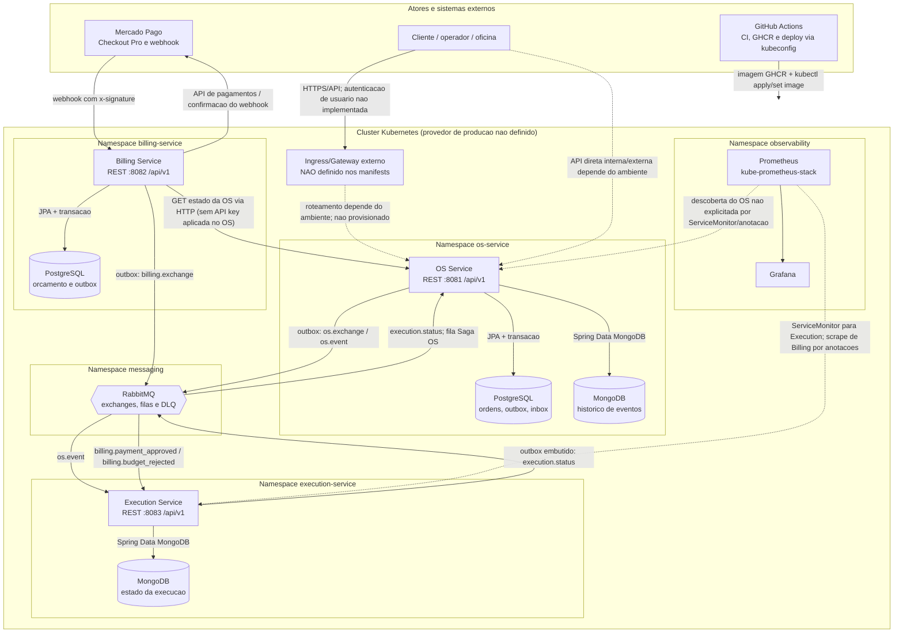

# Visao arquitetural

## Escopo e limites

O sistema e composto por tres microsservicos independentes. Cada servico e
responsavel por seu modelo e banco; nao ha transacao distribuida nem foreign
keys entre bancos. A comunicacao de dominio e principalmente por RabbitMQ.
Billing tambem consulta sincronamente o estado da OS e o provedor de pagamento.

O Terraform atual cria um cluster local Kind com tres nos para validar a
plataforma. Ele nao provisiona uma conta AWS, Azure, GCP ou um cluster gerenciado.
Os workflows de CI/CD dos servicos esperam um cluster Kubernetes externo,
configurado por `KUBE_CONFIG`; provedor, rede, entrada publica, TLS, DNS e
estrategia de backup desse ambiente nao estao definidos neste repositorio.

## Diagrama de componentes



O desenho de Ingress/Gateway e apenas uma lacuna/necessidade de ambiente, nao um
recurso provisionado. `Service` e `ClusterIP` nos manifestos dos servicos; nao
foi encontrado um recurso Ingress. A nuvem nao e especificada pelo codigo.

### Monitoramento observado

- O Terraform instala `kube-prometheus-stack` no namespace `observability`, com
  Prometheus e Grafana e retencao de Prometheus configurada para sete dias.
- Execution inclui um recurso `ServiceMonitor`.
- Billing inclui anotacoes `prometheus.io/scrape`, `path` e `port` no pod.
- OS expoe os endpoints Spring Actuator/Prometheus na configuracao da aplicacao,
  mas seu Deployment nao declara ServiceMonitor ou anotacoes equivalentes.
- Alertas, SLOs, dashboards de produto e retencao de logs nao estao definidos
  pelos artefatos examinados.

## Diagrama de sequencia: autenticacao como implementada

Nao existe um fluxo uniforme de login/token para clientes nas tres APIs. O
diagrama registra os controles que de fato existem; `API Key` e credencial de
servico, nao identidade/autorizacao de usuario final.

```mermaid
sequenceDiagram
  actor Caller as Cliente / servico chamador
  participant OS as OS Service
  participant Billing as Billing Service
  participant MP as Mercado Pago

  Note over Caller,OS: OS API nao aplica filtro de autenticacao/autorizacao nos endpoints examinados.
  Caller->>OS: POST /api/v1/orders
  OS-->>Caller: 201 Created (sem desafio de autenticacao)

  Note over Caller,Billing: Apenas /budgets/** requer X-API-Key.
  Caller->>Billing: POST /api/v1/budgets + X-API-Key
  Billing->>Billing: Comparacao constante da chave configurada
  alt chave ausente/invalida
    Billing-->>Caller: 503 se nao configurada; 401 se invalida
  else chave valida
    Billing-->>Caller: resposta do endpoint
  end

  MP->>Billing: POST /api/v1/webhooks/mercado-pago + x-signature
  Billing->>Billing: Verificar assinatura e identificadores
  Billing->>MP: Consultar pagamento pela API do provedor
  MP-->>Billing: Estado oficial, moeda, valor e referencia
  Billing->>Billing: Validar referencia/valor/moeda e persistir
```

O endpoint de webhook usa assinatura do provedor, nao `X-API-Key`. A validacao
de assinatura do webhook e especifica do Mercado Pago. O projeto nao deve ser
considerado pronto para exposicao publica de APIs de OS, Billing ou Execution
sem uma decisao e implementacao de identidade, autorizacao, TLS e politica de
acesso para os endpoints administrativos.

## Diagrama de sequencia: abertura da OS e progressao da Saga

`POST /api/v1/orders` cria a OS com status `RECEBIDA` e grava o evento na outbox
na mesma transacao PostgreSQL. O evento e publicado assincronamente. Diagnostico,
criacao/aprovacao do orcamento e checkout sao passos subsequentes iniciados por
operadores/oficina; nao sao uma chamada sincrona unica iniciada pelo `POST`.

```mermaid
sequenceDiagram
  actor Client as Cliente / operador
  participant OS as OS Service
  participant PG as PostgreSQL OS
  participant Outbox as OS Outbox Dispatcher
  participant MQ as RabbitMQ
  participant Exec as Execution Service
  participant Mongo as MongoDB Execution
  actor Workshop as Oficina
  participant Bill as Billing Service
  participant BPG as PostgreSQL Billing
  participant MP as Mercado Pago

  Client->>OS: POST /api/v1/orders (customerId, vehicleId, descricao)
  OS->>OS: Validar campos obrigatorios
  OS->>PG: BEGIN; inserir tb_order (RECEBIDA)
  OS->>PG: inserir order_outbox (ORDER_CREATED)
  OS->>PG: COMMIT
  OS-->>Client: 201 Created (id/status)
  Outbox->>PG: buscar eventos ainda nao publicados
  Outbox->>MQ: os.exchange / os.event
  Outbox->>PG: marcar evento publicado
  MQ->>Exec: fila de eventos de OS
  Exec->>Mongo: criar execution_work_orders (id = orderId)

  Workshop->>Exec: POST /api/v1/executions/{orderId}/diagnosis/start
  Workshop->>Exec: POST /api/v1/executions/{orderId}/diagnosis
  Workshop->>Bill: POST /api/v1/budgets (orderId, descricao, valor, X-API-Key)
  Bill->>OS: GET /api/v1/orders/{orderId} (consultar status)
  OS-->>Bill: status da OS
  Bill->>BPG: persistir budget PENDING_APPROVAL + outbox
  Bill-->>Workshop: 201 Created (id do orcamento)
  Workshop->>Bill: POST /api/v1/budgets/{id}/decision (approved=true)
  Bill->>BPG: marcar APPROVED + outbox
  Workshop->>Bill: POST /api/v1/budgets/{id}/checkout
  Bill->>MP: criar preferencia Checkout Pro
  MP-->>Bill: preference_id e checkout_url
  Bill-->>Workshop: checkout_url
  MP->>Bill: webhook de pagamento
  Bill->>MP: consultar pagamento oficial
  Bill->>BPG: validar valor/moeda e persistir PAID + outbox
  Bill->>MQ: billing.exchange / billing.payment_approved
  MQ->>Exec: evento de pagamento aprovado
  Exec->>Mongo: marcar pagamento e colocar OS na fila de reparo
```

### Falhas e compensacoes

- OS grava outbox e estado da ordem na mesma transacao PostgreSQL; o listener OS
  registra IDs recebidos em `saga_inbox`.
- Billing grava eventos em `outbox_event`; o publisher possui tentativas e
  `next_attempt_at`.
- Execution persiste IDs processados e eventos de saida no documento MongoDB;
  RabbitMQ aplica ate cinco tentativas de consumo e encaminha falhas para DLQ.
- Rejeicao do orcamento e cancelamento sao comunicados como evento e cancelam a
  execucao. O sistema impede iniciar/concluir trabalho em estado cancelado.
- Reembolso posterior a pagamento nao e automatico: Execution registra
  `refundRequired` e exige reconciliacao/estorno manual.
- A entrega end-to-end tem limites de consistencia e contratos que precisam ser
  testados conjuntamente. A existencia dos componentes de outbox/DLQ nao
  constitui garantia de recuperacao automatica para qualquer falha.
