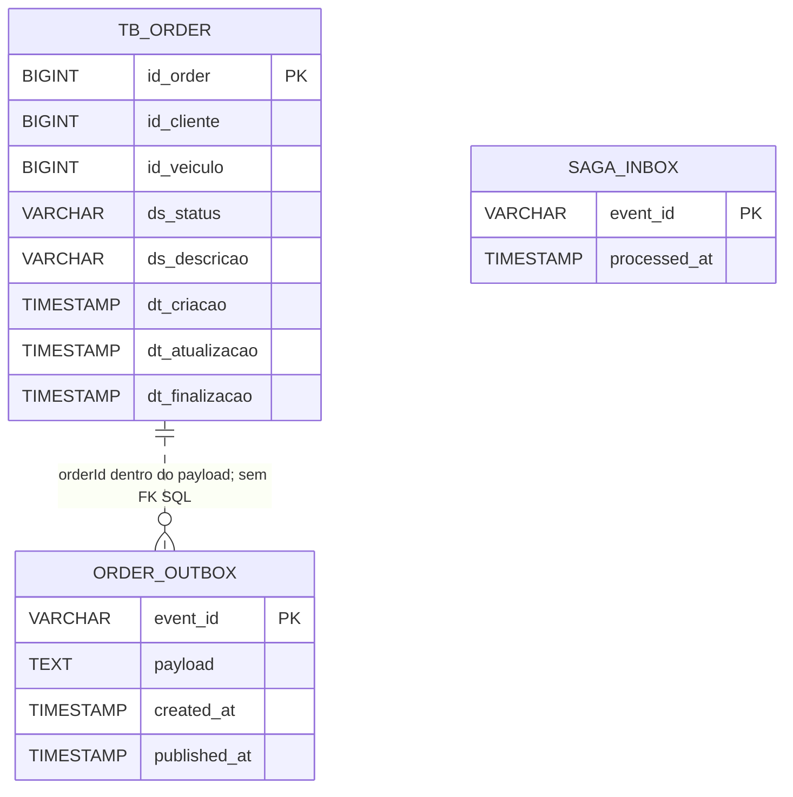
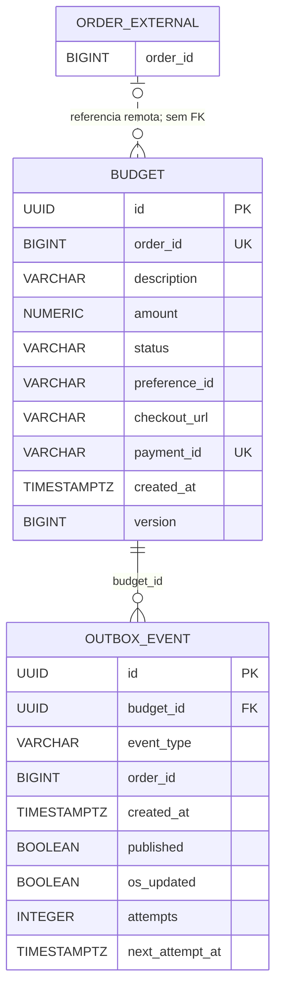
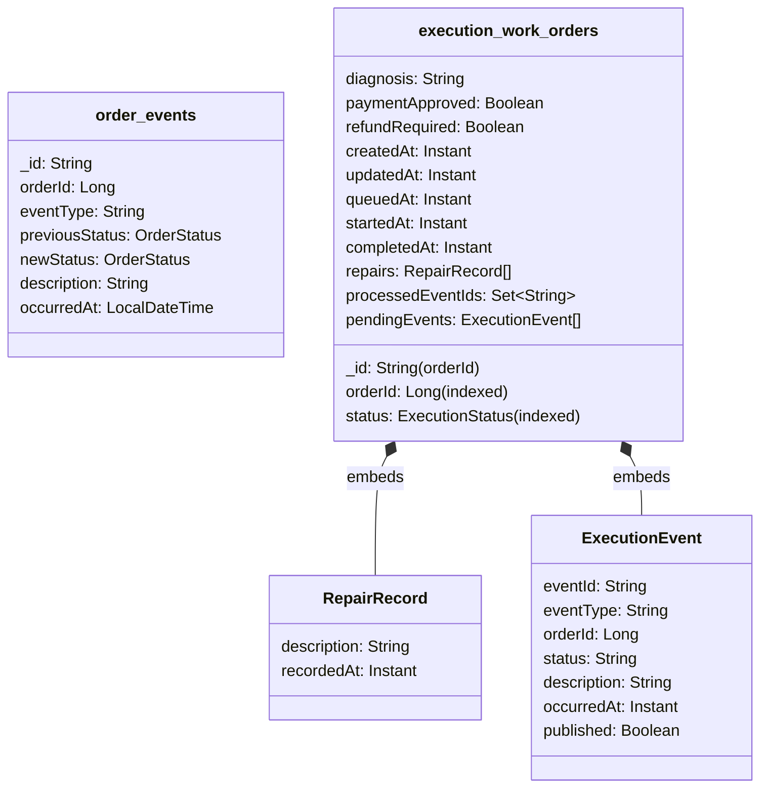

# Modelo de dados e justificativa

## Justificativa formal

### PostgreSQL para OS e Billing

OS e Billing usam dados com invariantes transacionais claros: ciclo de vida da
ordem, estado do orcamento, unicidade de orcamento por ordem, identificador
unico de pagamento e gravacao atomica de alteracao de dominio com evento de
outbox. PostgreSQL oferece transacoes ACID, constraints, indices e locking
adequados a essas invariantes.

Em Billing, `budget.order_id` e UNIQUE e `budget.version` usa optimistic locking.
`outbox_event.budget_id` tem FK para `budget.id`, de modo que eventos publicados
nao podem apontar para um orcamento inexistente. Em OS, ordem e outbox estao no
mesmo banco para evitar a janela de falha entre gravar a ordem e gravar o evento.

As tabelas de clientes e veiculos nao existem nesses servicos; `customerId` e
`vehicleId` sao identificadores fornecidos pelo chamador, sem FK local. Tambem
nao existe FK de `budget.order_id` para `tb_order`: os bancos sao separados por
microsservico, e Billing verifica a OS por API. Isso evita acoplamento de schema
e transacoes entre servicos, mas exige validacao de contrato e tratamento de
referencias remotas invalidas.

### MongoDB para historico OS e agregado Execution

O historico da OS e uma trilha de eventos append-only consultada por `orderId`;
MongoDB permite guardar os campos opcionais e evoluir o formato dos eventos sem
normalizar cada tipo de evento em tabelas relacionais. A ordem transacional
continua em PostgreSQL: MongoDB e usado para auditoria/historico, nao como fonte
principal do estado da OS.

Execution armazena um documento por OS em `execution_work_orders`. O documento
agrega status, diagnostico, marcadores de pagamento/estorno, reparos, IDs de
eventos processados e eventos pendentes. Esse agregado e lido/atualizado pelo
`orderId`; guardar seus subdados juntos reduz joins e permite persistir o estado
da execucao em uma unidade documental. Indices em `orderId`, `status` e
`(status, queuedAt)` atendem consultas por OS e fila.

Os campos `repairs`, `processedEventIds` e `pendingEvents` crescem no mesmo
documento. Se o historico de reparos ou de mensagens puder crescer sem limite,
deve-se definir retencao/arquivamento ou extrair colecoes relacionadas para
evitar crescimento ilimitado do documento.

## Diagrama ER: PostgreSQL OS

`ORDER_OUTBOX` e `SAGA_INBOX` nao declaram foreign keys para `TB_ORDER`. A
associacao desenhada por tracejado e semantica/payload, nao constraint relacional.
`SAGA_INBOX` nao tem uma relacao SQL com `TB_ORDER`: registra IDs de eventos
consumidos para deduplicacao, nao uma tabela de historico de estado da ordem.

## Diagrama ER: PostgreSQL Billing

`ORDER_EXTERNAL` e conceitual: a ordem e mantida pelo OS Service e consultada
por HTTP. Nao representa tabela de Billing. `amount` tem CHECK positivo no
schema; `order_id` e unico e `payment_id` e unico quando preenchido.

## Modelo documental: MongoDB

`order_events` e `execution_work_orders` sao colecoes de servicos/contextos
diferentes; nao ha transacao ou relacionamento MongoDB entre elas.

## Ajustes recomendados ao modelo relacional

1. Manter a propriedade do dado no servico que o cria. Se for necessario
   identificar cliente/veiculo de forma confiavel, consumir um contrato de
   identidade/cadastro ou manter uma referencia validada; nao introduzir FK para
   schema de outro servico.
2. Preservar `UNIQUE (order_id)` em `budget` enquanto a regra de negocio permitir
   somente um orcamento vigente por OS. Se houver revisoes, modelar uma entidade
   de versao e uma constraint para no maximo um orcamento ativo, em vez de
   remover a unicidade sem regra substituta.
3. Considerar tornar `order_outbox.payload` JSONB com colunas consultaveis para
   tipo, agregado e versao de schema; indexar pendencias com indice parcial
   existente e definir politica de limpeza para eventos publicados.
4. Adicionar chaves de correlacao e constraints explicitas nos eventos de outbox
   onde necessario; garantir que a limpeza nao remova mensagens ainda nao
   confirmadas por todos os consumidores.
5. Definir retencao/arquivamento para `saga_inbox`, eventos de auditoria e arrays
   de `ExecutionWorkOrder`; documentar limites, pois algumas colecoes/arrays
   crescem ao longo do tempo.
6. Planejar backup, restore e migracoes compativeis com deploy rolling para
   volumes PostgreSQL/MongoDB. O Terraform atual cria volumes persistentes, mas
   nao define rotina de backup ou recuperacao de desastre.

As sugestoes acima sao evolucoes propostas, nao alteracoes feitas ao schema atual.
